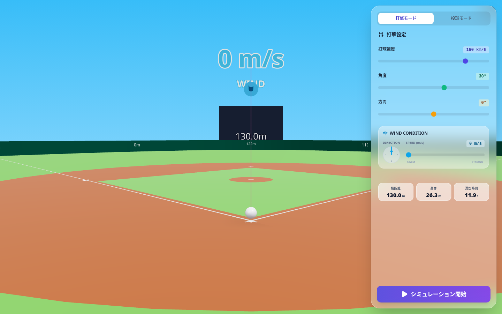
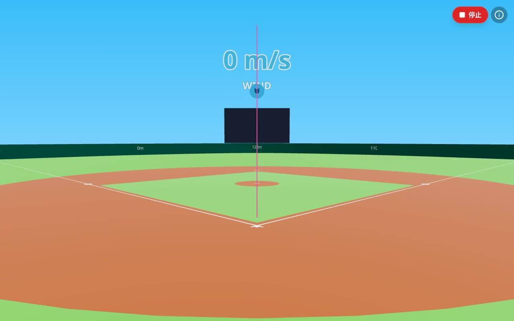
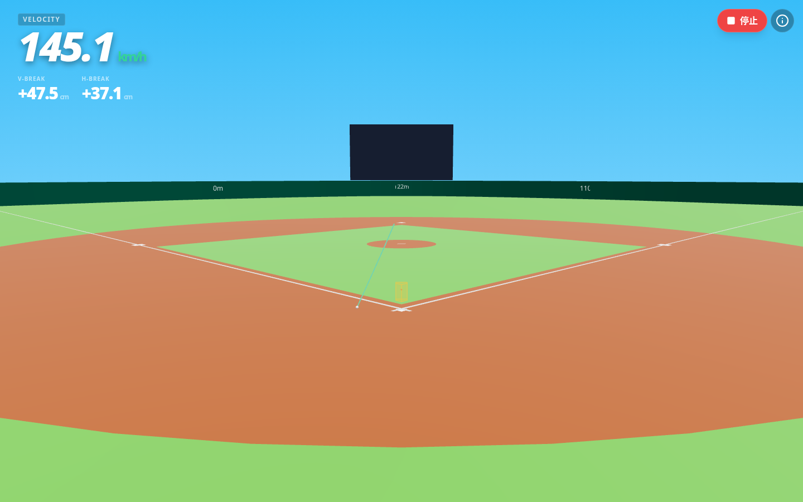
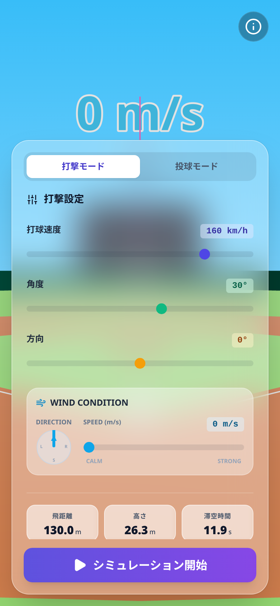

# Baseball Trajectory Sim 3D

打球と投球の軌道を、空気抵抗やマグヌス効果を含めた物理計算で求めて、3Dの球場に描くシミュレーターです。




## デモ動画

[](./demo.mp4)

打撃モードで条件を変えて打球を飛ばし、投球モードに切り替えて投げる流れ（ローカルで実行して録画、約1.6倍速）。

動画ファイル: [`demo.mp4`](./demo.mp4)

## 概要

React Three Fiber で作った球場に、計算した軌道を描画します。打撃モードと投球モードの2つがあります。

## 主な機能

### 打撃モード
- 打球速度（km/h）・打ち出し角度・方向を入力して軌道を計算
- 風速・風向きの設定
- 飛距離・最高到達点・滞空時間を表示
- フェンス（高さ4m）への衝突や跳ね返り、地面でのバウンドと転がりも簡易的に計算

### 投球モード
- 球速・回転数・回転効率・ジャイロ角・リリースの高さ／横位置／エクステンションなどを入力
- ホームベースまでの軌道を計算し、縦横の変化量（cm）を表示
- 狙ったコースに届くよう、投げ出す角度を逆算する機能

### 物理モデル（utils/physics.ts）
- 重力、空気抵抗（Cd = 0.30）、回転による揚力（マグヌス効果）を 0.01 秒刻みで数値積分
- 空気密度・ボールの質量や半径は一般的な値を固定で使用
- 実測データとの照合はしていない、学習・可視化用のモデルです

## 技術スタック

React 19 / TypeScript / Vite / three.js / @react-three/fiber / @react-three/drei / lucide-react / Tailwind CSS（CDN）

## 動かし方

```bash
npm install
npm run dev   # http://localhost:3000
```

ビルドは `npm run build`（出力先は `dist/`）。APIキーは不要です。

※ GitHub Pages（https://balloonnfusuuke.github.io/baseball1.github.io/）はビルド前のソースをそのまま配信しているため、現状は表示されません。公開する場合は `vite build --base=./` でビルドした `dist/` を配信してください。

## スクリーンショット

| 打撃モード | 投球モード | モバイル |
| --- | --- | --- |
|  |  |  |

---

## English

**Baseball Trajectory Sim 3D** computes batted-ball and pitch trajectories with gravity, drag and Magnus lift, and draws them in a 3D ballpark built with React Three Fiber.

- **Batting mode:** exit velocity, launch angle, spray angle and wind → distance, max height, hang time; simple wall collisions, bounces and roll
- **Pitching mode:** velocity, spin rate, spin efficiency, gyro angle and release point → path to the plate with vertical/horizontal break; can solve for release angles to hit a target location
- Fixed-step (0.01 s) numerical integration with constant air density and drag coefficient; an educational/visual model, not validated against tracking data

**Stack:** React 19, TypeScript, Vite, three.js, @react-three/fiber, @react-three/drei

**Run:** `npm install` → `npm run dev` (no API key needed)
